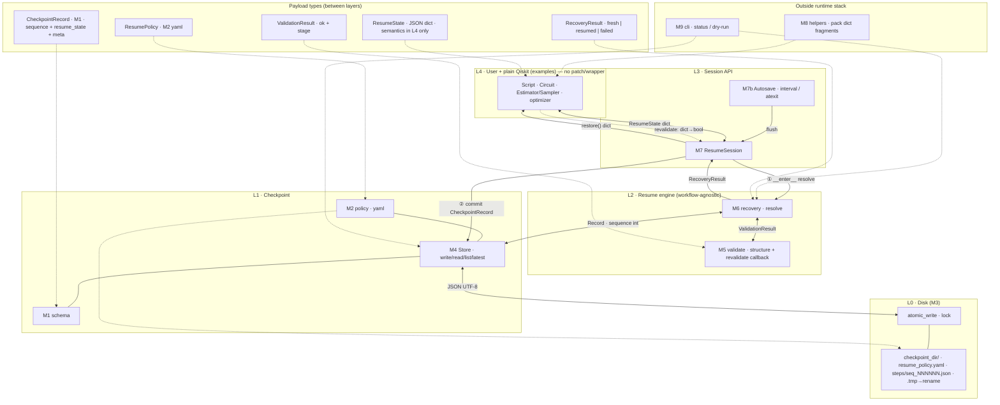

# Qiskit Resume

**Package:** `qiskit-resume` · **Import:** `qiskit_resume`

A checkpoint layer for **pausing and resuming** Qiskit workflows—especially variational algorithms and Primitives-based jobs.  
Like checkpoints in classical HPC or ML training, it **persists state after each step** so that when a run is interrupted, **re-running the same command** continues from the last valid checkpoint.

Designed for long jobs on **local simulators** and **remote backends** (e.g. IBM Quantum), including quota limits, timeouts, and process shutdown.

---

## Goals

- Persist progress for **optimization-loop** workflows (VQE, QAOA, ADAPT-VQE, etc.)
- Record **partial results and parameters** per `Estimator` / `Sampler` call and **retry from the failed step**
- **Roll back** to earlier steps when checkpoint validation fails (e.g. try up to N previous steps)
- Apply explicit **replay and warm-start policies** when backends or transpilation change
- Provide a **session/runner API** that minimizes changes to user code (planned)

---

## Scope

### Supported

| Workflow | Step definition | Typical checkpoint payload |
|----------|-------------------|----------------------------|
| Variational (VQE, QAOA, etc.) | One optimizer iteration | Parameters θ, optimizer internal state, iteration index, optional ⟨H⟩, convergence metadata |
| Primitives loop | One `Estimator` / `Sampler` call | Pub/circuit id, binding parameters, seed, measurement/expectation results, call index |
| ADAPT / growing circuits | One operator or layer added | Ansatz structure (circuit snapshot or builder state), θ, active operator list |
| Local Aer / `Statevector` (optional) | User-defined step | Above fields plus optional **simulator-only** statevector—for **reproducibility and debugging** |

**Resume behavior (common)**

1. Read the **latest `step_index`** from the checkpoint directory  
2. If configured, **validate**: recompute or compare stored ⟨H⟩/expectations against tolerance **δ**  
3. On validation failure, roll back to **`step_index - 1`, `-2`, …** (bounded by `max_rollback`)  
4. Continue the workflow from the **next step** after a valid checkpoint  

**Runtime**

- Python 3.10+ (target), **Qiskit** 1.x, **qiskit-algorithms**, **qiskit-nature** (chemistry examples)
- Local: Aer, reference primitives  
- Remote: IBM Quantum (`IBMBackend`, Runtime `Estimator`/`Sampler`)—API keys and credits are the user’s responsibility

---

### Not supported / not automatic

The following are **not** provided as a transparent universal snapshot, due to physics, information theory, or current NISQ hardware limits.

| Item | Explanation |
|------|-------------|
| Save mid-circuit **\|ψ⟩** on hardware for an arbitrary deep single `QuantumCircuit`, then run only the next gates | No-cloning, measurement collapse, exponential cost to specify a general state |
| Unconditional monkey-patch of **every** Qiskit API | APIs without a meaningful step require user-defined checkpoint units |
| **Automatic** quota or credit top-up | Checkpoints restore **where to resume**; account limits remain on the provider |
| **Bit-identical** reproduction after backend change | Layout, transpilation, and noise may differ—use **policy-based replay and validation** |

**Deep single-circuit workflows**

- Checkpoints store **circuit definition + parameters + optional layer index** only  
- On resume, **replay from \|0⟩** through the target layer (if layers are steps, rollback means recompute from layer k)  
- On hardware, expect **statistical** equivalence; on simulators, **deterministic** replay is possible  

---

## Checkpoint files (`.chk` / directory)

Checkpoints are stored as a **versioned directory** or a JSON/YAML file plus sidecars.

### Required metadata

```yaml
checkpoint_version: 1
workflow_id: "<uuid or user string>"
workflow_type: "vqe" | "primitive_loop" | "adapt_vqe" | "custom"
step_index: 7
step_total: 10          # optional, known ahead
created_at: "ISO-8601"
qiskit_version: "1.x.x"
backend:
  name: "ibm_..." | "aer_simulator" | "local"
  layout_hash: "<optional, for replay policy>"
```

### Variational (VQE, etc.)

```yaml
parameters: [ ... ]           # θ vector
optimizer:
  name: "SPSA"
  state: { ... }                # serializer-supported internal state
energy: -1.137                  # last ⟨H⟩, optional
energy_std: 0.002
circuit_ansatz_hash: "<hash>"
hamiltonian_hash: "<hash>"
```

### Primitive call

```yaml
call_index: 42
primitive: "estimator"
pubs: [ ... ]                   # or reference ids
bindings: [ ... ]
result: { ... }                 # cached expectation / counts
rng_seed: 12345
```

### Validation and rollback (`resume_policy.yaml` example)

```yaml
validate_on_resume: true
energy_tolerance: 0.001         # Ha, workflow-dependent
max_rollback: 5
on_backend_change: "replay_from_last_valid"  # | warm_start | fail
```

---

## Architecture

**Qiskit-native:** the layer handles checkpoints, policy, and resume only. Your code keeps using **plain Qiskit** (`Estimator`, `Sampler`, circuits, optimizers)—no required wrappers or monkey-patches.

**Unified resume:** recovery is **the same** for every workflow. The core stores an opaque `resume_state` dict per **sequence** (commit index). Meaning (θ, loop index, energies, etc.) lives in **your** script (layer L4).

Paths: **①** on process start — `resolve` → `restore()` → rebuild Qiskit from dict. **②** during the run — `commit` → `CheckpointRecord` → disk. Optional **autosave** repeats ② on a timer or at exit.

### Overview (single diagram)



### Shared types

| Type | Python | JSON | Rules |
|------|--------|------|--------|
| `Sequence` | `int` | integer ≥ 0 | Strictly increases per commit; no gaps |
| `WorkflowId` | `str` | string | Non-empty; one run per checkpoint directory |
| `ResumeState` | `dict[str, JSONValue]` | object | **Opaque to L0–L3**; you define keys (θ, indices, …) |
| `JSONValue` | — | null, bool, number, string, array, object | No raw `bytes` or Qiskit objects in the core path |
| `WorkflowLabel` | `str \| None` | string or omitted | Display/metadata only; **not** used in recovery |
| `Iso8601` | `str` | string | UTC timestamp recommended |

### Layer boundaries (inputs / outputs)

| Boundary | Direction | Payload | Notes |
|----------|-----------|---------|--------|
| L4 ↔ L3 | L4 → L3 | `ResumeState` dict | `update_pending(state)` or `commit(state=…)` |
| L4 ↔ L3 | L3 → L4 | `ResumeState` dict | `restore()`; empty `{}` if fresh run |
| L4 ↔ L3 | L4 → L3 | `Callable[[dict], bool]` | Optional `revalidate` on session (e.g. re-run Estimator) |
| L3 → L2 | startup | `resolve(store, policy, workflow_id, cb?)` | Path ① |
| L2 → L3 | startup | `RecoveryResult` | See table below |
| L3 → L1 | runtime | `CheckpointRecord` | Path ② on `commit` |
| L2 ↔ L1 | startup | `CheckpointRecord`, `sequence: int` | Read latest; rollback reads older sequences |
| L1 ↔ L0 | both | UTF-8 JSON / YAML bytes | `steps/seq_%06d.json`, `resume_policy.yaml` |

### Payload shapes (core)

**`RecoveryResult`** (M6 → M7):

| Field | Type | When set |
|-------|------|----------|
| `status` | `"fresh"` \| `"resumed"` \| `"failed"` | Always |
| `valid_sequence` | `int \| None` | Last checkpoint that passed validation |
| `record` | `CheckpointRecord \| None` | If a record was selected |
| `resume_state` | `dict \| None` | Copy of `record.resume_state` when resumed |
| `attempted_sequences` | `list[int]` | Newest-first rollback attempts |
| `failure_reason` | `str \| None` | If `status == "failed"` |

**`ValidationResult`** (M5 → M6):

| Field | Type | Values |
|-------|------|--------|
| `ok` | `bool` | |
| `reason` | `str \| None` | Human-readable |
| `stage` | `str` | `"structure"` \| `"chain"` \| `"revalidate"` |

**`CheckpointRecord`** (M1; file `steps/seq_NNNNNN.json`):

| Field | Required | JSON type | Notes |
|-------|----------|-----------|--------|
| `checkpoint_version` | yes | integer | `1` for schema v1 |
| `workflow_id` | yes | string | Must match session |
| `sequence` | yes | integer ≥ 0 | Matches filename |
| `created_at` | yes | string | ISO-8601 |
| `workflow_label` | no | string | Optional label |
| `resume_state` | yes | object | May be `{}` |
| `meta` | no | object | e.g. package version, content hash |

**`ResumePolicy`** (M2; file `resume_policy.yaml`):

| Field | Type | Typical values |
|-------|------|----------------|
| `validate_on_resume` | bool | `true` / `false` |
| `max_rollback` | int | e.g. `5` |
| `on_backend_change` | string | `fail`, `warm_start_only`, `replay_from_last_valid` |
| `auto_commit_interval_s` | number \| null | `null` = off |
| `auto_commit_on_exit` | bool | flush pending on exit |
| `revalidate_requires_callback` | bool | if true and no callback → fail revalidate |
| `callback_hints` | object | e.g. `energy_tolerance`; read by **your** callback/helpers only |

### Module I/O (implementation units)

| Module | Layer | Inputs | Outputs |
|--------|-------|--------|---------|
| **M3** `fs.py` | L0 | `Path`, `str` or `bytes`; lock path | Final `Path`; lock handle; raises `OSError`, `LockError` |
| **M1** `schema.py` | L1 | `CheckpointRecord` or JSON `str` | JSON `str` or `CheckpointRecord`; `SchemaError` |
| **M2** `policy.py` | L1 | YAML path or `ResumePolicy` | `ResumePolicy` or YAML file |
| **M4** `checkpoint.py` | L1 | `CheckpointRecord`; `sequence: int` | `Path` on write; `Record \| None`; `list[int]` sequences |
| **M5** `validate.py` | L2 | `CheckpointRecord`, `WorkflowId`, `ResumePolicy`, optional `Callable[[dict], bool]` | `ValidationResult` |
| **M6** `recovery.py` | L2 | `CheckpointStore`, `ResumePolicy`, `WorkflowId`, optional revalidate callback | `RecoveryResult` |
| **M7** `session.py` | L3 | `checkpoint_dir: Path`, `workflow_id: str`, optional `policy`, `revalidate`, `workflow_label` | `restore()→dict`, `next_sequence()→int`, `commit()→int`, flags `is_fresh` / `is_resumed` |
| **M7b** `autosave.py` | L3 | `ResumeSession`, `ResumePolicy` | Calls `commit()` on interval / atexit |
| **M8** `helpers/` | — | Python values (θ, energy, …) | `dict` fragments for `resume_state` |
| **M9** `cli.py` | — | CLI path to `checkpoint_dir` | Text or JSON status; dry-run `RecoveryResult` JSON |
| **M10** `examples/` | L4 | Env, checkpoint dir | Qiskit side effects + checkpoint files |

### M7 `ResumeSession` API

| Method / ctor arg | Input type | Output type |
|-------------------|------------|-------------|
| `checkpoint_dir` | `pathlib.Path` | — |
| `workflow_id` | `str` | — |
| `policy` | `ResumePolicy \| None` | defaults if omitted |
| `revalidate` | `Callable[[dict], bool] \| None` | — |
| `workflow_label` | `str \| None` | — |
| `restore()` | — | `dict` |
| `last_valid_sequence()` | — | `int \| None` |
| `next_sequence()` | — | `int` (next commit index; `0` if fresh) |
| `update_pending(state)` | `dict` (replaces pending) | `None` |
| `commit(state=None)` | optional `dict` (else pending) | `int` (committed sequence) |

### L4 contract (your Qiskit code)

| Direction | Form | Responsibility |
|-----------|------|----------------|
| Resume IN | `dict` from `restore()` | Deserialize to θ, loop index, optimizer state; rebuild Qiskit objects |
| Save OUT | `dict` → `commit` / `update_pending` | Convert results to JSON-safe values (`list[float]`, `int`, `str`, nested `dict`) |
| Validate | `revalidate(dict) -> bool` | Optional; e.g. one Estimator call to confirm stored energy |

**On disk (L0):** `{checkpoint_dir}/resume_policy.yaml`, optional `.lock`, `steps/seq_NNNNNN.json` (written via `seq_NNNNNN.json.tmp` then atomic rename).

---

## Usage (target API)

```python
from qiskit_resume import ResumeSession, ResumePolicy

policy = ResumePolicy(
    checkpoint_dir="./chk/my_run",
    max_rollback=5,
    energy_tolerance=1e-3,
)

with ResumeSession(policy=policy, workflow_id="h2_vqe_001") as session:
    for step in session.loop(range(session.start_step, max_iter)):
        energy = estimator.run(...).result()
        session.commit(step_index=step, energy=energy, parameters=theta)
        theta = optimizer.step(energy)
```

Re-run after interruption:

```bash
python run_h2_vqe.py   # same script; resumes if chk exists
```

CLI (planned):

```bash
python -m qiskit_resume status ./chk/my_run
python -m qiskit_resume resume ./chk/my_run --dry-run
```

---

## IBM Quantum and quota scenarios

- Local **chk** remains if the job stops due to **queue wait, session timeout, or exhausted credits**  
- After credits or connectivity return, **re-run the same script**—`Estimator` calls continue from the last **committed** step  
- If the backend name changes: policy may **full replay**, **θ warm-start only**, or **abort with warning**

---

## Chemistry (qiskit-nature) integration (planned)

- Store `ElectronicStructureProblem` / Hamiltonian hashes; **refuse resume** on mismatch  
- Examples: H₂, LiH with UCCSD / UCCSD0; record PySCF integrals version  
- Later: unified checkpoints for **classical steps** (e.g. microkinetics) and **quantum steps** under `workflow_type: "hybrid"`

---

## Roadmap

### MVP

- [ ] Checkpoint schema v1 (JSON) + atomic write  
- [ ] `ResumeSession` + `iteration` step preset  
- [ ] VQE example (local Estimator)  
- [ ] `max_rollback` + energy tolerance validation  
- [ ] `resume` / `status` CLI  

### v0.2

- [ ] IBM backend metadata and transpile hash  
- [ ] `estimator_call` step preset  
- [ ] qiskit-nature H₂ example  

### v0.3

- [ ] ADAPT circuit snapshots  
- [ ] Optional Aer `Statevector` checkpoint (simulator only)  
- [ ] Docs: recommended policies when backends change  

---

## Project layout (planned)

```
qiskit-resume/
├── README.md
├── pyproject.toml
├── qiskit_resume/
│   ├── schema.py
│   ├── fs.py
│   ├── policy.py
│   ├── checkpoint.py
│   ├── validate.py
│   ├── recovery.py
│   ├── session.py
│   ├── autosave.py
│   ├── helpers/
│   └── cli.py
├── examples/
│   ├── h2_vqe_local.py
│   └── primitive_loop.py
└── tests/
```

---

## License

TBD

## Contributing

TBD
