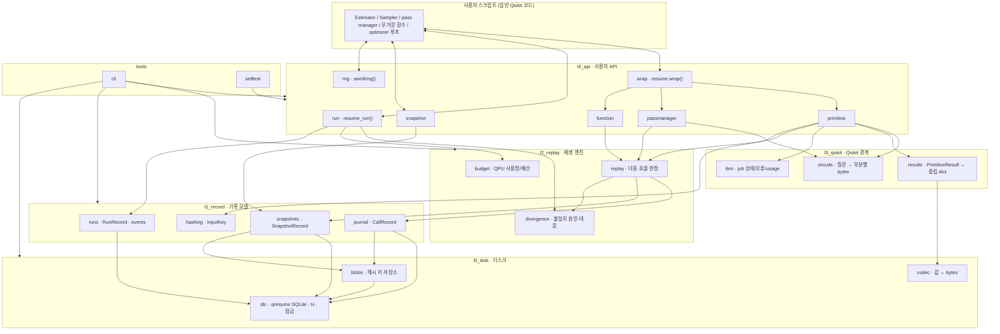
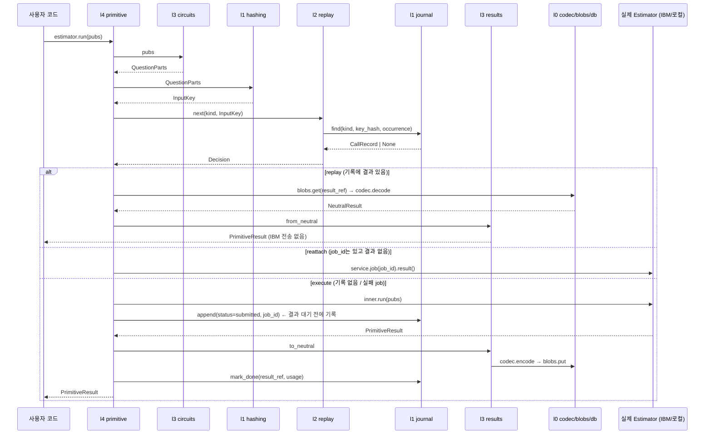

# qiskit-resume v1 — 아키텍처 (계층 · 모듈 · 입출력 계약)

> 설계 근거: [`DECISIONS.md`](DECISIONS.md) (D-001~D-015) · 진행: [`REWRITE_PLAN.md`](REWRITE_PLAN.md)
> 이 문서는 **구조와 흐름**(계층, 모듈, 누가 누구에게 무엇을 넘기는지)을 다룹니다.
> 함수 시그니처·필드 타입·오류·불변식 같은 **정밀 입출력 정의는 [`CONTRACTS.md`](CONTRACTS.md)** 가 정본이며, 각 모듈 `__init__.py` docstring에 해당 절 번호가 적혀 있습니다.

---

## 1. 계층 규칙

```
tools      (cli, selftest)                 ── 무엇이든 import 가능
l4_api     사용자 API                       ── l0~l3 import 가능
l3_qiskit  Qiskit 경계 (Qiskit 의존부 전부)  ── l0만 import 가능 (codec 용)
l2_replay  재생 엔진                        ── l0, l1
l1_record  기록 모델                        ── l0
l0_disk    디스크                           ── 표준 라이브러리 + numpy만
```

1. **아래 계층만 import** 한다. 위 계층·옆 계층 import 금지. (`tests/test_layers.py`가 자동 검사)
2. **Qiskit은 `l3_qiskit` 와 `l4_api` 에서만** import 한다. → Qiskit 버전이 바뀌면 l3만 고친다 (D-013).
3. 같은 계층 안의 모듈 간 의존은 아래 표에 **명시된 것만** 허용.
4. 각 모듈 폴더 = `__init__.py`(계약 docstring + 공개 이름만 export) + `core.py`(구현). 다른 모듈은 **`__init__`에 export된 이름만** 사용.
6. 각 모듈의 테스트는 `tests/<계층>/test_<모듈>.py` — 모듈 단독으로 테스트 (아래 계층만 실제 사용).
7. **코드(.py)는 ASCII 문자만** — 한국어·특수문자(—, §, → 등) 금지. Windows 콘솔(cp949)에서 출력이 깨지거나 오류가 나지 않도록. 한국어 설명은 docs/와 README_ko.md에만. (`tests/test_layers.py`가 자동 검사)
5. 계층 사이를 오가는 데이터는 아래 **§3 Payload 타입**만 쓴다.

---

## 2. 전체 그림



---

## 3. Payload 타입 (계층 사이를 오가는 데이터)

| 타입 | 정의 위치 | 내용 | 흐름 |
|---|---|---|---|
| `bytes` | — | 직렬화된 값 | l0 ↔ 모든 계층 |
| `BlobRef` = `str` | l0 blobs | SHA-256 hex (덩어리 저장소 키) | l1 ↔ l0 |
| `InputKey` | l1 hashing | `key_hash: str`, `parts: dict[str, str]` (부분명 → 부분 해시) | l3/l4 → l1 → l2 |
| `CallRecord` | l1 journal | id, run_id, seq, kind, key_hash, occurrence, parts, status, job_id, backend, inputs_ref, result_ref, usage_s, duration_s, created_at, finished_at, error | l1 ↔ l2 ↔ l4 |
| `SnapshotRecord` | l1 snapshots | id, run_id, position, state_ref, rng_ref, created_at, valid | l1 ↔ l2 ↔ l4 |
| `RunRecord` | l1 runs | id, started_at, ended_at, status, host, pid, code_fingerprint, settings, env | l1 ↔ l2 ↔ l4 |
| `Decision` | l2 replay | action(`replay` \| `reattach` \| `execute`), record, divergence | l2 → l4 |
| `Divergence` | l2 replay | call 위치, 기록된 InputKey vs 이번 InputKey, 달라진 부분 목록 | l2 → l2 divergence |
| `Verdict` | l2 divergence | level(`info`/`warning`/`error`), message, action(`continue`/`stop`) | l2 → l4 |
| `UsageSummary` | l2 budget | 28일 사용 초, 예산 잔여, 다음 회복 시점 | l2 → l4/tools |
| `QuestionParts` | l3 circuits | `dict[str, bytes]` (circuit / params / observables / shots / options …) | l3 → l1 hashing |
| `NeutralResult` | l3 results | codec 가능한 dict (배열 + 정보 + 형식 버전) | l3 ↔ l0 codec |
| `JobState` / `ErrorKind` | l3 ibm | 정규화된 job 상태 / 실패 원인 분류 | l3 → l4 |
| `EventRecord` | l1 runs | id, run_id, at, level, kind, detail | l1 → l4/tools |
| `Settings` | l4 run | resume_run 인자 (코드 인자만, D-010) | l4 → l1 runs (기록) |

---

## 4. 모듈별 계약

표기: **IN** = 받는 것 · **OUT** = 돌려주는 것 · **의존** = import 허용 대상 · 상태 = ✅구현 / 🔜예정(단계)

### l0_disk — 디스크 (Qiskit 무관 · 내용 무관)

| 모듈 | 책임 | IN | OUT | 의존 | 상태 |
|---|---|---|---|---|---|
| `db` | `.qresume` SQLite 파일. meta 테이블, 상위 모듈용 `ensure_schema`, 원자적 트랜잭션, 쓰기 단일 프로세스 잠금(OS 잠금, 사망 시 자동 해제), 읽기 전용 열기, 실행 중 안전 복사, 무결성 검사 | 파일 경로 | `ExperimentDB`(`tx()`, `get_meta/set_meta`), `backup_copy(src,dst)→Path`, `verify_file(path)`; 오류 `AlreadyRunningError` `IntegrityError` `FormatError` | — | ✅ P1 |
| `blobs` | 해시 키 덩어리 저장 (중복 제거). 생성 시 자기 테이블 생성 — 트랜잭션 밖에서 만들 것 | `bytes`, kind | `BlobRef`; `get(BlobRef)→bytes` | db | ✅ P1 |
| `codec` | 값 ↔ bytes (배열은 바이너리, 저장 불가 값은 즉시 오류+위치) | Python 값 / numpy | `bytes`; `decode(bytes)→값`; `EncodeError` | — | ✅ P1 |

### l1_record — 기록 모델 (Qiskit 무관 · 의미 판단 없음, 저장/조회만)

| 모듈 | 책임 | IN | OUT | 의존 | 상태 |
|---|---|---|---|---|---|
| `hashing` | 부분별 bytes → SHA-256 `InputKey`; 실수 배열 유효숫자 12자리 정규화 | `QuestionParts` | `InputKey`; `normalize_floats(arr)→bytes` | l0 codec | ✅ |
| `journal` | 호출 기록 추가·상태 갱신·조회·무효 처리 | `CallRecord` 필드, `(kind, key_hash, occurrence)` | `CallRecord \| None`, 목록 | l0 db, blobs | ✅ |
| `snapshots` | 스냅샷 저장·최신 유효본 조회·무효 처리 | run_id, position, state `bytes`, rng `bytes` | `SnapshotRecord` | l0 db, blobs | ✅ |
| `runs` | 실행(run) 기록, 설정 이력, 이벤트 로그(경고·force·무효 이동 등) | `Settings`, 코드 지문, 환경 정보 | `RunRecord`, 이전 run 조회 | l0 db | ✅ |

### l2_replay — 재생 엔진 (Qiskit 무관 · 규칙/판단 담당)

| 모듈 | 책임 | IN | OUT | 의존 | 상태 |
|---|---|---|---|---|---|
| `replay` | 이번 실행의 호출 순서를 따라가며 "기록에서 꺼낼지 / IBM job 재연결할지 / 새로 실행할지" 판정. `(kind, key_hash)`별 등장 횟수로 매칭 (D-005) | kind, `InputKey`, 시작 position(스냅샷) | `Decision` | l1 hashing, journal, snapshots | ✅ |
| `divergence` | 불일치 원인 분류·대응 (코드 지문 변경 → warning / 스냅샷 누락 → error+force 안내 / force → 진행+기존 기록 무효 보관) (D-006, D-012, D-014) | `Divergence`, 코드 지문 변경 여부, 스냅샷 시작 여부, force, on_divergence | `Verdict` | l1 journal, runs · l2 replay | ✅ |
| `budget` | QPU 사용량 28일 집계, 예산 한도 판정, 다음 job 비용 추정 (D-009) | journal 기록, `qpu_budget_s` | `UsageSummary`, `can_submit()→bool` | l1 journal | ✅ |

### l3_qiskit — Qiskit 경계 (Qiskit 의존부 전부 · 판단 없음, 변환만)

| 모듈 | 책임 | IN | OUT | 의존 | 상태 |
|---|---|---|---|---|---|
| `circuits` | 질문(pubs·회로·관측량·θ·shots·옵션)을 결정적 bytes 부분들로 분해; 회로 QPY 입출력 | Qiskit pubs / QuantumCircuit | `QuestionParts`; `circuit_to_qpy / circuit_from_qpy` | (Qiskit) | ✅ |
| `results` | `PrimitiveResult` ↔ 우리 중립 형식 (D-013) | `PrimitiveResult` / `NeutralResult` | 반대쪽 | l0 codec, (Qiskit) | ✅ |
| `ibm` | IBM job 상태 정규화, 오류 원인 분류(할당량/장비/회로/TTL), usage 읽기, job 재조회 (`[ibm]` 선택 설치) | `RuntimeJobV2`, service, job_id | `JobState`, `ErrorKind`, usage 초 | (qiskit-ibm-runtime) | ✅ |

### l4_api — 사용자 API (조립 담당)

| 모듈 | 책임 | IN | OUT | 의존 | 상태 |
|---|---|---|---|---|---|
| `run` | `resume_run(path, **settings)` 컨텍스트: 파일 열기·잠금, run 기록, 코드 지문, seed 고정, 새 실험 안내, 장비 변경 경고 | 경로, `Settings`(코드 인자만) | `ResumeRun` 핸들 | l0~l3 · l4 rng, snapshot | ✅ |
| `rng` | `resume.seed`, `resume.seed_for(name)`, `resume.rng(name=None, seed=None)`, 전역 RNG·`algorithm_globals` 고정, RNG 상태 캡처/복원 (D-006, D-020) | 기록된 seed | int seed, numpy Generator, rng 상태 bytes | l0~l3 | ✅ |
| `wrap` | `resume.wrap(x)` 분기: primitive / pass manager / 함수 (D-003) | 사용자 객체 | 감싼 객체 | l4 primitive, passmanager, function | ✅ |
| `primitive` | Estimator·Sampler `run()` 가로채기: 질문 해시 → 판정 → 재생/재연결/실행, job_id 선기록, 재시도 (D-008) | pubs, 옵션 | `run()→job`, `job.result()→PrimitiveResult` | l1 hashing·journal, l2 replay·budget, l3 circuits·results·ibm · l4 run | ✅ |
| `passmanager` | 변환 캐시: (원본 해시 + 장비 이름) → QPY 회로 (D-005/D-007); `resume.pass_manager()` 한 줄 생성 (D-020) | 원본 회로 / backend + preset 옵션 | 변환 회로 / 기록되는 pass manager | l1, l2 replay, l3 circuits · l4 run, rng | ✅ |
| `device` | `resume.backend()`: 장비를 첫 실행에 고르고 기록, 재실행 때 같은 장비 (D-020) | service, 장비 이름(선택) | backend 객체 | l4 run | ✅ |
| `function` | 함수 결과 기록·재생, 느린 함수 추천 (D-011) | 함수 인자 | 반환값 | l0 codec, l1, l2 replay · l4 run | ✅ |
| `snapshot` | `run.snapshot(state)`, `run.load_snapshot()` (RNG 상태 자동 포함) | state dict | state dict \| None | l1 snapshots, l4 rng | ✅ |

### 4.1 모듈 의존 표 (자동 검사: `tests/test_layers.py` 의 `ALLOWED`)

같은 계층 또는 아래 계층 중 **여기 적힌 것만** import 가능. l4_api·tools는 l0~l3의 어떤 모듈이든 사용 가능하고, l4 안에서는 적힌 형제만.
Qiskit import는 l3_qiskit · l4_api · tools 에서만. 다른 모듈의 `core`를 직접 import 금지(패키지 공개 이름만).

| 모듈 | import 허용 |
|---|---|
| l0_disk.db | — |
| l0_disk.blobs | l0_disk.db |
| l0_disk.codec | — |
| l1_record.hashing | l0_disk.codec |
| l1_record.journal | l0_disk.db, l0_disk.blobs |
| l1_record.snapshots | l0_disk.db, l0_disk.blobs |
| l1_record.runs | l0_disk.db |
| l2_replay.replay | l1_record.hashing, l1_record.journal, l1_record.snapshots |
| l2_replay.divergence | l1_record.journal, l1_record.runs, l2_replay.replay |
| l2_replay.budget | l1_record.journal |
| l3_qiskit.circuits | l0_disk.codec, (Qiskit) |
| l3_qiskit.results | l0_disk.codec, (Qiskit) |
| l3_qiskit.ibm | (qiskit-ibm-runtime) |
| l4_api.run | l0~l3, l4_api.rng, l4_api.snapshot |
| l4_api.rng | l0~l3 |
| l4_api.snapshot | l0~l3, l4_api.rng |
| l4_api.wrap | l0~l3, l4_api.primitive, l4_api.passmanager, l4_api.function |
| l4_api.primitive / function | l0~l3, l4_api.run |
| l4_api.passmanager | l0~l3, l4_api.run, l4_api.rng (`pass_manager()`의 `seed_for`) |
| l4_api.device | l0~l3, l4_api.run |

### tools — 스택 밖

| 모듈 | 책임 | 상태 |
|---|---|---|
| `cli` | `qresume` status · check · selftest · copy · export · pack/unpack · quota · fork · compact (D-012/D-014) | ✅ |
| `selftest` | 로컬에서 여러 지점 강제 중단·재개 → 결과 비교 (D-012) | ✅ |

---

## 5. 워크플로 (모듈 사이에 무엇이 오가는가)

### 5.1 감싼 Estimator 호출 1회



### 5.2 실행 시작 (`with resume_run(...)`)

1. `l4 run` → `l0 db.open_for_run(path)` — 잠금 실패 시 `AlreadyRunningError` (D-014)
2. `l4 run` → `l1 runs` 이전 run 조회 → 없으면 "새 실험으로 시작" 안내
3. `l4 run` → `l1 runs.start(Settings, 코드 지문, 환경)` — 불변 설정(seed, 실험 ID) 불일치면 오류 (D-010)
4. `l4 rng` → 기록된 seed 적용 (D-006)
5. `l4 run` → `l2 replay` 초기화 (스냅샷 사용 시 `l1 snapshots` 최신 유효본, 뒤에 검증할 기록이 있는 것만)
6. 사용자 코드 진행 → 5.1 반복
7. 종료 → `l1 runs.finish(status)` → `l0 db.close()` (잠금 해제)

### 5.3 불일치 발생

`l2 replay`가 `Divergence` 생성 → `l2 divergence`가 `Verdict` 결정 → `l4`가 경고 출력 또는 중단 → `l1 runs`에 이벤트 기록 → (force면) `l1 journal`에서 이후 기록 무효 보관 (D-001)

---

## 6. 디스크 레이아웃 (`.qresume` 내부 테이블)

각 테이블의 **스키마(DDL)와 쓰기는 소유 모듈만** 가진다. l0 db는 `meta`만, 상위 모듈은 `ExperimentDB.ensure_schema(ddl)`로 자기 테이블을 만든다 → 기록 형태가 그 기록을 쓰는 코드 옆에 있음.

| 테이블 | 소유 모듈 (스키마+쓰기) | 내용 |
|---|---|---|
| `meta` | l0 db | 형식 버전, 생성 시각, (l4 run이 기록) seed·실험 ID |
| `blobs` | l0 blobs | 해시 → bytes (회로 QPY, 결과, 스냅샷 상태 등) |
| `runs` | l1 runs | 실행마다 1행 |
| `events` | l1 runs | 경고·force·무효 이동·장비 변경 등 로그 |
| `calls` | l1 journal | 호출 기록 (`(kind, key_hash, occurrence)` 유효 기록 유일) |
| `snapshots` | l1 snapshots | 스냅샷 |

옆 파일: `<이름>.qresume.lock` (쓰기 잠금용, 남아 있어도 무해), 쓰는 순간에만 잠깐 생기는 `<이름>.qresume-journal`. 저널 모드는 어디서나 rollback journal 하나 (D-017).
